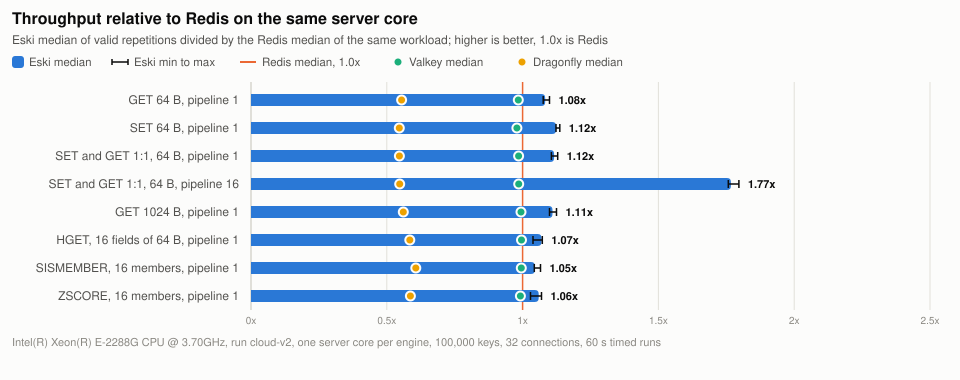
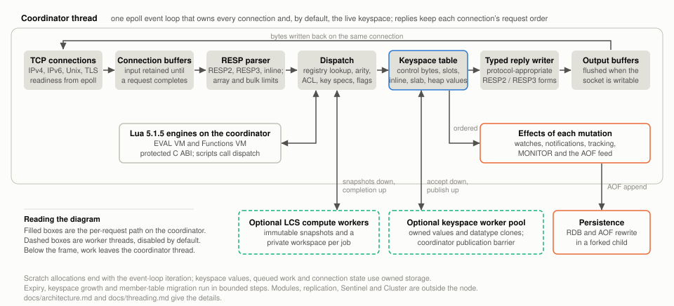

<p align="center">
  <picture>
    <source media="(prefers-color-scheme: dark)" srcset="docs/img/wordmark-dark.svg">
    
  </picture>
</p>

<p align="center">
  
  
</p>

Eski is an in-memory data store for one machine. It speaks RESP, so existing clients, tools and scripts connect to it unchanged, and it implements the single-node command surface: strings, hashes with field expiry, lists, sets, sorted sets, geospatial search, bitmaps, HyperLogLog, streams, pub/sub, transactions, ACLs, RDB and append-only persistence, Lua 5.1.5 scripting with Function libraries and an interactive debugger, plus an optional memcached text endpoint over the same keys. It is written in Odin with a pinned C Lua runtime, licensed under Apache-2.0, and verified against the upstream conformance suite on every change.

Modules, replication, Sentinel and Cluster are outside this repository. Eski is the node; coordination between nodes belongs to a separate layer.

## Why Eski

- **It is fast where it counts.** On the recorded run below, one server core, Eski serves more requests per second than each of the other three engines in every workload, and its p99 latency is never above theirs. At pipeline 16, where the kernel's share of each request shrinks, the gap widens sharply.
- **It is lean.** After filling 10,000,000 keys of 64 bytes, Eski holds each key in 113 resident bytes; the fill table below records the numbers for all four engines.
- **It is honest about measurement.** Every number on this page comes from a committed dataset with its raw per-second series, machine samples and exclusion reasons, generated into this README by a script that refuses to run when the tables are stale. The method is described below and can be repeated on a rented server in an afternoon.
- **It is compatible by evidence, not by claim.** The reference server's test suite runs against Eski with a protected baseline; the conformance table below is regenerated from that run, and skipped tests are listed rather than counted.
- **It is one binary with no runtime.** No garbage collector, no virtual machine for the engine itself, no worker threads unless you turn them on. The event loop, the keyspace and the reply path are written in Odin and read top to bottom.

## Recorded measurements

<!-- BEGIN GENERATED BENCHMARKS -->

These results come from the committed [cloud-v2 dataset](bench/testbed/runs/cloud-v2/dataset.json). Every engine uses the same server CPU assignment and memory caps, separate client cores, a fresh dataset and a warmup before timing. The run records power, temperature, CPU-idle and load-generator limits. Invalid repetitions retain their reason, and client-limited measurements remain annotated. These measurements describe the recorded machine and workload; they establish no multicore scaling or universal throughput claim.

<picture>
<source media="(prefers-color-scheme: dark)" srcset="docs/img/throughput-ratio-dark.svg">

</picture>

Recorded medians from `bench/testbed/runs/cloud-v2`, using valid repetitions only. These are measurements from one machine, not a claim about every workload or deployment.

| Workload | Eski ops/s | Redis ops/s | Valkey ops/s | Dragonfly ops/s |
| --- | ---: | ---: | ---: | ---: |
| GET 64 B, pipeline 1 | 285,885 | 263,891 | 259,754 | 146,333 |
| SET 64 B, pipeline 1 | 287,436 | 255,839 | 250,447 | 139,667 |
| SET and GET 1:1, 64 B, pipeline 1 | 286,969 | 257,182 | 253,437 | 140,526 |
| SET and GET 1:1, 64 B, pipeline 16 | 2,619,156 | 1,482,209 | 1,461,018 | 811,474 |
| GET 1024 B, pipeline 1 | 265,856 | 239,516 | 238,146 | 134,335 |
| HGET, 16 fields of 64 B, pipeline 1 | 258,774 | 241,966 | 240,959 | 141,464 |
| SISMEMBER, 16 members, pipeline 1 | 267,274 | 255,664 | 254,425 | 155,152 |
| ZSCORE, 16 members, pipeline 1 | 268,848 | 253,793 | 251,743 | 148,986 |

No included repetition was client limited. The observed GET 64 B pipeline 1 median throughput ratio is **1.08x Eski / Redis**. Excluded repetitions receive no inferred score. [Method, ranges, images and exclusions](docs/benchmarks.md).

Read the [benchmark method and tables](docs/benchmarks.md), the [self-contained report](bench/testbed/runs/cloud-v2/report.html) and the [recorded charts](bench/testbed/runs/cloud-v2/charts/throughput.svg).

<!-- END GENERATED BENCHMARKS -->

Reproduce the tables and badges from the committed inputs, or measure again on a machine of your own:

```sh
python3 -I test/readme_tables.py
python3 -I test/readme_tables.py --check
```

[Run the comparison on a new machine](docs/benchmarks.md#run-the-comparison-on-a-new-machine) lists the ten commands that take a clone of this repository to a committed run directory.

## Try it

Build on Linux with Odin, clang, OpenSSL 3 and libunwind development libraries, GNU ar, sha256sum, flock and Python available. The compiler release used by the container build is pinned by checksum in the [Dockerfile](Dockerfile); Lua sources and patches are vendored for offline builds.

```sh
./build.sh check
./build.sh
./bin/eski --bind 127.0.0.1 --port 6399
```

In another terminal, use any RESP client:

```sh
redis-cli -p 6399 SET demo:message hello
redis-cli -p 6399 GET demo:message
redis-cli -p 6399 HSET demo:user name Ada
redis-cli -p 6399 HGETALL demo:user
redis-cli -p 6399 EVAL 'return redis.call("INCR",KEYS[1])' 1 demo:counter
```

The example binds to loopback on purpose. Configure network access and [ACLs](docs/acl.md) before exposing a listener. Authentication and append-only persistence are opt-in; scheduled snapshots use the standard default save rules. [Build, run and test](docs/build-run-test.md) covers compiler discovery, configuration files, containers, durability and every verification layer.

## How it works

<p align="center">
  <picture>
    <source media="(prefers-color-scheme: dark)" srcset="docs/img/architecture-dark.svg">
    
  </picture>
</p>

**One loop, one owner.** The coordinator runs on a single event-loop thread. Linux epoll reports ready sockets, each connection keeps its own input and output buffers, and the parser keeps an incomplete request until more bytes arrive. Complete arguments reach a command registry whose entries carry the handler, arity, flags, key specifications and argument metadata. Handlers operate on the selected database and write typed RESP replies straight into the connection's output buffer. Pipelining preserves each connection's command order. One request is one read and one write; the loop reads the clock through the vDSO and never enters the kernel just to look at the time.

**Two allocation lifetimes.** Each event-loop iteration has a scratch allocator that is reset when the iteration ends. Parsing, argument handling and reply formatting live there. Anything that must outlive the iteration, a stored value, a queued operation, a blocked client, uses owned storage. This one rule separates transient work from the keyspace and is the reason memory accounting in Eski is a matter of reading the code rather than guessing what a collector will do.

**A keyspace built for the cache.** The database table is open-addressed with a structure-of-arrays layout: compact control bytes identify candidate slots before any full key comparison, and slot metadata carries expiry and access information. Short keys and short string values fit in their own handles with no separate allocation. Larger payloads use slab or heap storage, and collection values point at type-specific objects. Growth is incremental, so no operation rehashes the whole database at once; hash, set and sorted-set member tables migrate in bounded steps during quiet periods.

**Expiry without surprises.** Expiry combines checks on access with periodic maintenance that walks metadata inside a work budget. Hash fields have their own deadline registry. Keyspace notifications, watched-key invalidation, client tracking and the persistence feed are tied to mutations, so they all observe the same change in the same order. Memory limits add eviction and client-buffer policies; they do not pretend that a configured limit is an operating-system RSS cap.

**Optional workers, explicit boundaries.** A default-disabled keyspace pool executes eligible commands across every data type, including atomic multi-key work and TTL options, with coordinator publication of effects in accepted order. AOF, WATCH, tracking, notifications, MONITOR and memory pressure keep their coordinator boundaries, and the [threading guide](docs/threading.md) states exactly which commands cross which barrier. Separate compute workers can take large LCS calculations over owned snapshots. Both are off by default; the recorded measurements above run the single-threaded configuration.

**Lua behind a wall.** [Scripts and Functions](docs/scripting.md) run on the coordinator in persistent Lua 5.1.5 engines behind a protected C ABI. EVAL and Function libraries use separate engines, builtin tables are read-only, and every invocation uses the caller's ACL and command-effect hooks. Successful writes survive a later script error and reach the AOF; the engine boundary keeps a Lua error from unwinding into Odin frames.

The source is organized by command group. Files such as `src/cmd_string.odin`, `src/cmd_hash.odin` and `src/cmd_stream.odin` register handlers, with storage packages underneath and shared dispatch, reply, ACL and persistence services around them. The [architecture page](docs/architecture.md) and the [documentation index](docs/README.md) go deeper.

## Why Odin

Eski is about 110,000 lines of Odin in one `src` tree, built by one shell script with one pinned compiler release. The language was chosen for what it leaves out as much as for what it offers.

- **Allocators are part of the call, not of the runtime.** Odin passes an allocator in its implicit context, so the per-iteration scratch lifetime described above is a single line at the top of the loop rather than a discipline every contributor has to remember. Owned storage is equally explicit. There is no garbage collector to schedule, tune or wait for, which is why the latency table is flat across workloads.
- **No hidden control flow.** No exceptions, no destructors, no operator overloading, no silent conversions between distinct types. A request path that is one read, one dispatch and one write in the source is that in the binary. When something costs a microsecond, it is in the code you are looking at.
- **Data layout is yours.** Value types, slices, explicit struct layout and first-class structure-of-arrays support make the control-byte table, the inline handles and the slab storage ordinary Odin rather than a fight with the type system.
- **C is a foreign import away.** The Lua 5.1.5 runtime, OpenSSL 3 for TLS and libunwind for native diagnostics are bound with a handful of foreign import blocks and no glue generator. The C library's vDSO clock is one of them.
- **The compiler is the linter.** The check step runs `odin check` with `-vet` and `-strict-style` before every build, locally and in the container, so unused values, shadowing and style drift fail the build rather than a review. The Dockerfile pins the compiler release by sha256 and the image build checks the binary, the version, the licence and the source tree it contains.

The trade-off is a smaller ecosystem. The engine was written for Eski; the functions ported from Valkey and from BSD-licensed upstream files, the Lua runtime and the transport libraries are listed with their notices in [THIRD_PARTY_NOTICES.md](THIRD_PARTY_NOTICES.md).

## How we measure

The numbers on this page are produced by a test bed that treats a benchmark as an experiment with a protocol, not as a script that prints a number. The [benchmark page](docs/benchmarks.md) has the full method; this is the shape of it.

- **Four engines, one core.** Eski and the three engines named in the tables run one at a time in fresh containers pinned by image digest, with the same server CPU, the same 8 GiB memory cap and the same 6 GiB maxmemory, persistence off, host loopback networking. Dragonfly runs one proactor thread on that core. The load generator runs on separate physical cores, the controller on another, and CPU 0 belongs to the kernel. Simultaneous multithreading is off, so a CPU number is a physical core.
- **Eight workloads, four repetitions.** GET, SET and a 1:1 mix at 64 bytes and pipeline 1; the mix at pipeline 16; GET at 1024 bytes; HGET, SISMEMBER and ZSCORE over 16-element values. Each case preloads 100,000 keys, warms up for 10 seconds and times 60 seconds over 32 connections. Engine order rotates so every engine takes every position once per workload.
- **Gates before, rules during.** A case starts only when the package is at or below 55 C, the role CPUs are at least 95 percent idle, 30 seconds have passed since the last case and the readings have been stable for 10 seconds. During the case, a process from outside the run on any core, a thermal throttle count, a frequency policy change, a kernel thread bound to the server core, or a single second below half the run's median rate invalidates the case with a named reason. Invalid cases are published with that reason and never averaged in.
- **The raw evidence is kept.** Every case keeps its resolved plan, the raw memtier output with its per-second series, machine samples with the eight CPU time fields and softirq counters of every core, and the ownership events of every process the run started. The dataset, receipts, charts and report are committed together, and the README tables are generated from the dataset by a script whose check mode fails when they drift.
- **Memory is measured by filling.** A separate fill stores 10,000,000 keys of 64 bytes per engine on the same core and cap, waits for used memory to settle and the keyspace to finish rehashing, and reports resident bytes per key.
- **Changes to Eski are measured against Eski first.** A relative harness runs the candidate and its parent build at the same time on symmetric cores, swaps lanes every round and reports server CPU time per command with a recorded A/A noise floor. A change inside the floor is reported as no measurable change.

What these numbers are not: a multicore scaling result, a claim about your workload, or a ranking. They are the throughput, latency and memory of four engines on one recorded machine, with the exclusions visible.

## Compatibility and verification

The reference server's test suite is downloaded with a checksum, run against Eski, and compared with a protected baseline of recorded passes. The gate fails on any regression. The expanded run below counts every unit's passes, failures and skips; a skipped test establishes nothing and is listed so that it cannot be mistaken for coverage. Separate managed fixtures exercise server restarts, Lua and Functions, networking and persistence, and the smoke test diffs replies and persistence behaviour against reference containers. The [verification record](docs/build-run-test.md#verification) describes every check, the allocator and storage-representation differences, and the unqualified resource cases.

<!-- BEGIN GENERATED CONFORMANCE -->

The recorded gate preserves **1504 / 1504 baseline passes** across 28 compared units, with **0 regressions**. The expanded recorded run has **2082 passes, 0 failures and 137 skips** across 43 units, with **0 unit errors**. The observed run records **1528 passes in the 28 compared units**, including **24 additional passes** beyond the protected baseline. No test failures or unit errors were recorded; skipped tests do not establish coverage. See the [conformance record](docs/conformance.md).

| Unit | Passed | Failed | Skipped | Unit errors |
| --- | ---: | ---: | ---: | ---: |
| acl | 87 | 0 | 7 | 0 |
| acl-v2 | 36 | 0 | 1 | 0 |
| auth | 8 | 0 | 1 | 0 |
| bitfield | 18 | 0 | 1 | 0 |
| bitops | 49 | 0 | 2 | 0 |
| dump | 13 | 0 | 15 | 0 |
| expire | 62 | 0 | 8 | 0 |
| geo | 64 | 0 | 0 | 0 |
| hyperloglog | 27 | 0 | 1 | 0 |
| info | 24 | 0 | 2 | 0 |
| info-command | 3 | 0 | 0 | 0 |
| introspection | 36 | 0 | 16 | 0 |
| introspection-2 | 46 | 0 | 1 | 0 |
| keyspace | 59 | 0 | 0 | 0 |
| latency-monitor | 16 | 0 | 0 | 0 |
| lazyfree | 9 | 0 | 1 | 0 |
| limits | 0 | 0 | 1 | 0 |
| maxmemory | 27 | 0 | 5 | 0 |
| memefficiency | 5 | 0 | 2 | 0 |
| multi | 46 | 0 | 17 | 0 |
| networking | 0 | 0 | 4 | 0 |
| other | 24 | 0 | 6 | 0 |
| pause | 18 | 0 | 1 | 0 |
| protocol | 25 | 0 | 0 | 0 |
| pubsub | 47 | 0 | 0 | 0 |
| pubsubshard | 0 | 0 | 2 | 0 |
| querybuf | 3 | 0 | 0 | 0 |
| quit | 3 | 0 | 0 | 0 |
| scan | 25 | 0 | 1 | 0 |
| slowlog | 16 | 0 | 2 | 0 |
| sort | 54 | 0 | 1 | 0 |
| tracking | 58 | 0 | 0 | 0 |
| type/hash | 75 | 0 | 0 | 0 |
| type/hash-field-expire | 112 | 0 | 14 | 0 |
| type/incr | 33 | 0 | 0 | 0 |
| type/list | 281 | 0 | 14 | 0 |
| type/list-2 | 2 | 0 | 0 | 0 |
| type/list-3 | 11 | 0 | 0 | 0 |
| type/set | 117 | 0 | 3 | 0 |
| type/stream | 82 | 0 | 0 | 0 |
| type/stream-cgroups | 62 | 0 | 4 | 0 |
| type/string | 79 | 0 | 2 | 0 |
| type/zset | 320 | 0 | 2 | 0 |
| **Total** | **2082** | **0** | **137** | **0** |

<!-- END GENERATED CONFORMANCE -->

```sh
bash test/run_packages.sh
./test/conformance/run.sh --suite redis --baseline test/conformance/baseline-redis.json
bash test/smoke.sh
python3 -I test/readme_tables.py --check
```

The package runner exercises debug, sanitizer and release builds. Conformance downloads a checksum-verified test suite; fetching it before smoke enables the fixture-dependent corrupt-payload comparisons. The [conformance page](docs/conformance.md) records the suite results and reproduction commands, and the [scripting](docs/scripting.md#verification) and [threading](docs/threading.md#keyspace-correctness-checks) guides describe their dedicated checks. Optional [formal verification projects](proofs/README.md) model selected storage, command-state, parser, codec and arithmetic properties in Lean and compare them against the Odin implementation.

## Command groups

The inventory below is generated from the running server's `COMMAND DOCS` metadata and cross-checked against `COMMAND LIST`. Compatibility stubs and behavioural limits are explained in the group pages and the [complete command reference](docs/commands.md).

<!-- BEGIN GENERATED COMMANDS -->

The running executable registers **237 top-level commands** and **333 commands including subcommands**. Compatibility stubs remain subject to the exclusions above. [Arguments and metadata summaries](docs/commands.md) come from `COMMAND DOCS`; every name below is cross-checked against `COMMAND LIST`.

| Group | Registered commands and subcommands |
| --- | --- |
| bitmap | `BITCOUNT`, `BITFIELD`, `BITFIELD_RO`, `BITOP`, `BITPOS`, `GETBIT`, `SETBIT` |
| connection | `AUTH`, `CLIENT`, `CLIENT CACHING`, `CLIENT GETNAME`, `CLIENT GETREDIR`, `CLIENT HELP`, `CLIENT ID`, `CLIENT INFO`, `CLIENT KILL`, `CLIENT LIST`, `CLIENT NO-EVICT`, `CLIENT NO-TOUCH`, `CLIENT PAUSE`, `CLIENT REPLY`, `CLIENT SETINFO`, `CLIENT SETNAME`, `CLIENT TRACKING`, `CLIENT TRACKINGINFO`, `CLIENT UNBLOCK`, `CLIENT UNPAUSE`, `ECHO`, `HELLO`, `PING`, `QUIT`, `RESET`, `SELECT` |
| generic | `COPY`, `DEL`, `DUMP`, `EXISTS`, `EXPIRE`, `EXPIREAT`, `EXPIRETIME`, `KEYS`, `MIGRATE`, `MOVE`, `OBJECT`, `OBJECT ENCODING`, `OBJECT FREQ`, `OBJECT HELP`, `OBJECT IDLETIME`, `OBJECT REFCOUNT`, `PERSIST`, `PEXPIRE`, `PEXPIREAT`, `PEXPIRETIME`, `PTTL`, `RANDOMKEY`, `RENAME`, `RENAMENX`, `RESTORE`, `SCAN`, `SORT`, `SORT_RO`, `TOUCH`, `TTL`, `TYPE`, `UNLINK`, `WAIT`, `WAITAOF` |
| geo | `GEOADD`, `GEODIST`, `GEOHASH`, `GEOPOS`, `GEORADIUS`, `GEORADIUS_RO`, `GEORADIUSBYMEMBER`, `GEORADIUSBYMEMBER_RO`, `GEOSEARCH`, `GEOSEARCHSTORE` |
| hash | `HDEL`, `HEXISTS`, `HEXPIRE`, `HEXPIREAT`, `HEXPIRETIME`, `HGET`, `HGETALL`, `HINCRBY`, `HINCRBYFLOAT`, `HKEYS`, `HLEN`, `HMGET`, `HMSET`, `HPERSIST`, `HPEXPIRE`, `HPEXPIREAT`, `HPEXPIRETIME`, `HPTTL`, `HRANDFIELD`, `HSCAN`, `HSET`, `HSETNX`, `HSTRLEN`, `HTTL`, `HVALS` |
| hyperloglog | `PFADD`, `PFCOUNT`, `PFDEBUG`, `PFMERGE`, `PFSELFTEST` |
| list | `BLMOVE`, `BLMPOP`, `BLPOP`, `BRPOP`, `BRPOPLPUSH`, `LINDEX`, `LINSERT`, `LLEN`, `LMOVE`, `LMPOP`, `LPOP`, `LPOS`, `LPUSH`, `LPUSHX`, `LRANGE`, `LREM`, `LSET`, `LTRIM`, `RPOP`, `RPOPLPUSH`, `RPUSH`, `RPUSHX` |
| pubsub | `PSUBSCRIBE`, `PUBLISH`, `PUBSUB`, `PUBSUB CHANNELS`, `PUBSUB HELP`, `PUBSUB NUMPAT`, `PUBSUB NUMSUB`, `PUBSUB SHARDCHANNELS`, `PUBSUB SHARDNUMSUB`, `PUNSUBSCRIBE`, `SPUBLISH`, `SSUBSCRIBE`, `SUBSCRIBE`, `SUNSUBSCRIBE`, `UNSUBSCRIBE` |
| scripting | `EVAL`, `EVAL_RO`, `EVALSHA`, `EVALSHA_RO`, `FCALL`, `FCALL_RO`, `FUNCTION`, `FUNCTION DELETE`, `FUNCTION DUMP`, `FUNCTION FLUSH`, `FUNCTION HELP`, `FUNCTION KILL`, `FUNCTION LIST`, `FUNCTION LOAD`, `FUNCTION RESTORE`, `FUNCTION STATS`, `SCRIPT`, `SCRIPT DEBUG`, `SCRIPT EXISTS`, `SCRIPT FLUSH`, `SCRIPT HELP`, `SCRIPT KILL`, `SCRIPT LOAD` |
| server | `ACL`, `ACL CAT`, `ACL DELUSER`, `ACL DRYRUN`, `ACL GENPASS`, `ACL GETUSER`, `ACL HELP`, `ACL LIST`, `ACL LOAD`, `ACL LOG`, `ACL SAVE`, `ACL SETUSER`, `ACL USERS`, `ACL WHOAMI`, `BGREWRITEAOF`, `BGSAVE`, `COMMAND`, `COMMAND COUNT`, `COMMAND DOCS`, `COMMAND GETKEYS`, `COMMAND GETKEYSANDFLAGS`, `COMMAND HELP`, `COMMAND INFO`, `COMMAND LIST`, `CONFIG`, `CONFIG GET`, `CONFIG HELP`, `CONFIG RESETSTAT`, `CONFIG REWRITE`, `CONFIG SET`, `DBSIZE`, `DEBUG`, `FLUSHALL`, `FLUSHDB`, `INFO`, `LASTSAVE`, `LATENCY`, `LATENCY DOCTOR`, `LATENCY GRAPH`, `LATENCY HELP`, `LATENCY HISTOGRAM`, `LATENCY HISTORY`, `LATENCY LATEST`, `LATENCY RESET`, `LOLWUT`, `MEMORY`, `MEMORY DOCTOR`, `MEMORY HELP`, `MEMORY MALLOC-STATS`, `MEMORY PURGE`, `MEMORY STATS`, `MEMORY USAGE`, `MONITOR`, `SAVE`, `SHUTDOWN`, `SLOWLOG`, `SLOWLOG GET`, `SLOWLOG HELP`, `SLOWLOG LEN`, `SLOWLOG RESET`, `SWAPDB`, `TIME` |
| set | `SADD`, `SCARD`, `SDIFF`, `SDIFFSTORE`, `SINTER`, `SINTERCARD`, `SINTERSTORE`, `SISMEMBER`, `SMEMBERS`, `SMISMEMBER`, `SMOVE`, `SPOP`, `SRANDMEMBER`, `SREM`, `SSCAN`, `SUNION`, `SUNIONSTORE` |
| sorted-set | `BZMPOP`, `BZPOPMAX`, `BZPOPMIN`, `ZADD`, `ZCARD`, `ZCOUNT`, `ZDIFF`, `ZDIFFSTORE`, `ZINCRBY`, `ZINTER`, `ZINTERCARD`, `ZINTERSTORE`, `ZLEXCOUNT`, `ZMPOP`, `ZMSCORE`, `ZPOPMAX`, `ZPOPMIN`, `ZRANDMEMBER`, `ZRANGE`, `ZRANGEBYLEX`, `ZRANGEBYSCORE`, `ZRANGESTORE`, `ZRANK`, `ZREM`, `ZREMRANGEBYLEX`, `ZREMRANGEBYRANK`, `ZREMRANGEBYSCORE`, `ZREVRANGE`, `ZREVRANGEBYLEX`, `ZREVRANGEBYSCORE`, `ZREVRANK`, `ZSCAN`, `ZSCORE`, `ZUNION`, `ZUNIONSTORE` |
| stream | `XACK`, `XADD`, `XAUTOCLAIM`, `XCLAIM`, `XDEL`, `XGROUP`, `XGROUP CREATE`, `XGROUP CREATECONSUMER`, `XGROUP DELCONSUMER`, `XGROUP DESTROY`, `XGROUP HELP`, `XGROUP SETID`, `XINFO`, `XINFO CONSUMERS`, `XINFO GROUPS`, `XINFO HELP`, `XINFO STREAM`, `XLEN`, `XPENDING`, `XRANGE`, `XREAD`, `XREADGROUP`, `XREVRANGE`, `XSETID`, `XTRIM` |
| string | `APPEND`, `DECR`, `DECRBY`, `GET`, `GETDEL`, `GETEX`, `GETRANGE`, `GETSET`, `INCR`, `INCRBY`, `INCRBYFLOAT`, `LCS`, `MGET`, `MSET`, `MSETNX`, `PSETEX`, `SET`, `SETEX`, `SETNX`, `SETRANGE`, `STRLEN`, `SUBSTR` |
| transactions | `DISCARD`, `EXEC`, `MULTI`, `UNWATCH`, `WATCH` |

<!-- END GENERATED COMMANDS -->

## Direction and licence

Every command group of a single node is implemented and verified as described above. Eski is now growing into a single-node memory engine for AI applications: vector sets, the search interface that the LangChain and LlamaIndex integrations use, full-text and hybrid retrieval, and simulation testing of durability, each built on foundations proven in isolation first. [ROADMAP.md](ROADMAP.md) gives the order, what each milestone adds and the evidence that closes it. Distributed management is outside this node and belongs to a separate layer.

Eski is licensed under [Apache-2.0](LICENSE). Third-party components retain their own terms, recorded in [THIRD_PARTY_NOTICES.md](THIRD_PARTY_NOTICES.md).

Eski is an independent project, not affiliated with, endorsed or certified by Redis Ltd. Redis is a registered trademark of Redis Ltd.; any rights therein are reserved to Redis Ltd.
