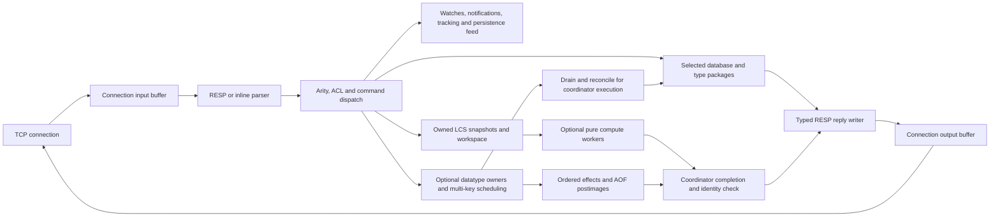
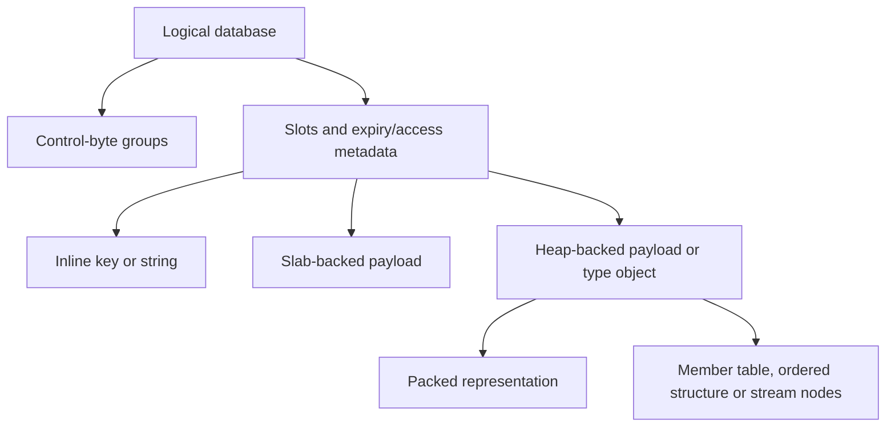

# Architecture

Eski has one foreground coordinator loop that owns connection state and, in the default configuration, the live keyspace. Each connection owns its input/output buffers, authentication state, selected database, protocol mode and optional subscription, tracking, blocked-operation or transaction state. Linux epoll supplies readiness events; the loop accepts connections, reads available bytes, executes requests and flushes replies. Optional [LCS compute workers](threading.md) use immutable snapshots and private workspaces while the coordinator continues servicing other connections. The separate, default-disabled keyspace pool executes eligible datatype commands over independently owned values, with coordinator publication and explicit barriers as described below.

## Parsing and execution

The request parser distinguishes complete, incomplete and malformed input and applies array/bulk limits before dispatch. It preserves input ownership where inline parsing needs a stable buffer. A connection can pipeline multiple complete commands. Dispatch resolves a registered command and optional subcommand, checks arity, derives key arguments, enforces ACL and loading/transaction restrictions, and invokes the handler. RESP2 and RESP3 use the same command semantics with protocol-appropriate reply forms.

The default temporary allocator is reset at the event-loop iteration boundary. A command can use scratch storage for transient processing, but data retained by the database, a queued operation or a connection must own its allocation. Replies remain owned until written. See [connections and protocol](connections-and-protocol.md) and [transactions](transactions.md).

Eligible large LCS requests can leave one pending computation on a connection. Their arguments and values are copied before admission, and later commands on that connection wait for completion. Worker code accesses its private snapshots/workspace; the coordinator formats replies and updates hooks/statistics. Admission has fixed job and byte bounds and falls back to synchronous execution under pressure, inside transactions/loading, or for tracking-enabled sources. LCS computation is independent of the separate keyspace command pool. Compute workers stop and join before background persistence forks and shutdown; see [threading](threading.md) for lifecycle and observation details.

The keyspace pool assigns each database/key identity an owner and executes eligible string, list, hash, set, sorted-set/geo, stream, bitmap and HLL operations. Multi-key commands wait for every required owner and execute once; commands on disjoint owners can run concurrently. Workers operate on owned values and datatype clones. The coordinator retains an older database view until a barrier imports values and access/expiry metadata, and it publishes effects and replies in accepted order. A connection can keep up to 16 accepted commands in flight; a command that stays on the coordinator, or an admission or protocol error, first drains them, so replies keep request order.

AOF, WATCH, tracking/NOLOOP, notifications and MONITOR consume ordered coordinator effects. Registered blocked keys and Memcached metadata take per-key coordinator fallback, while unrelated keys remain candidates. Memory-policy configuration alone does not exclude workers; actual pressure uses coordinator eviction, and LFU access uses captured policy/time and private random state. Global scans, transactions, Lua/functions, persistence commands and physical storage inspection retain barriers. Paused expired keys and hashes fall back to preserve expiry semantics. Loading, child and per-connection restrictions remain explicit.

Reconciliation transfers state without repeating commands or emitting duplicate insertion notifications. Plain SET commands retain SET records. Hash commands publish canonical translated AOF effects with actual field-expiry deletions and captured absolute deadlines. Other eligible worker commands may record immutable RESTORE/ABSTTL postimages, so the log need not match original command spellings. Snapshot-budget failure restores worker state and retries the accepted handler once without repeating admission or eviction gates. Fork paths drain and join workers before the fork; parent workers can resume against the parent's independent state. Dedicated datatype, feature and sanitizer checks cover these mechanisms; current throughput and full single-node compatibility are separate qualifications. See [threading](threading.md) for coverage and memory costs.

## Lua evaluation

Scripting embeds pinned Lua 5.1.5 behind the Odin host's binary C ABI. EVAL retains one VM; Function libraries share a separate persistent VM. All allocation-capable Lua API work and error unwinding stay inside protected C calls; Odin callbacks return normally before C converts results or raises Lua errors. The source cache owns original source bytes and SHA1 metadata, with VM allocation, host capture and returned buffers accounted separately.

The coordinator reconciles keyspace workers before entry and runs admitted inner commands synchronously through a dedicated reply capture. Callbacks reuse actual caller ACL, key hooks, tracking, statistics and translated AOF effects without recursively dispatching on the live source connection. Expiry checks retain frozen command time, including inside EXEC, and TIME uses the cached command timestamp during the invocation. Other ordinary commands, maintenance and blocked consumers cannot interleave; restricted BUSY service can authenticate clients and process cancellation/no-save abort requests. Connection activity retains real wall time without advancing the expiry clock.

Successful inner writes survive later errors and join one AOF effect group, including scripts inside MULTI. Builtin tables are read-only, text loaders reject bytecode, and user-owned tables support ordinary Lua 5.1 metatables and raw access. Optional allocation/output controls and sticky terminal failures preserve the runtime boundary. Hooks remain cooperative and scripts consume foreground time. See [scripting](scripting.md) for the supported API, persistent library configuration, cancellation policy and verification results.

## Keyspace and values

The database table separates compact control bytes from a structure-of-arrays slot region. Lookup hashes a key, checks a group of control bytes and compares only candidate keys. Slots carry expiry/access metadata and compact key/value handles. Short strings fit in handles; larger payloads use slab or heap storage, and collection handles reference type-specific objects. The representations and accounting are in `src/table.odin`, `src/value.odin` and `src/memory_storage.odin`.

Storage packages manage lists, hashes, sets, sorted sets, packed values, bitmaps, HLL and stream records. Representation changes depend on size/configuration rather than changing the logical type. Ownership and usable-memory accounting flow back to the database. An allocation limit or representation threshold should not be interpreted as an exact process-RSS guarantee.

## Maintenance

Keyspace resizing and member-table migration use bounded work steps. The event loop also advances maintenance while traffic is quiet. Slab reclamation and lazy freeing have separate work queues. The periodic cron path performs expiry work, persistence scheduling, subscription maintenance, idle-client checks and statistics updates.

Expiry is lazy on access and active through a budgeted sweep over database metadata. Hash field deadlines use a registry so active field expiry can find relevant hashes without sweeping every hash. A key mutation also participates in watched-key invalidation, pub/sub notifications, tracking invalidation and the persistence feed. These effects are coordinated with transaction and blocked-client execution.

## Persistence and blocking work

RDB snapshots and append-only files are independent local durability mechanisms. Background save/rewrite operations use process/fork plumbing and shared accounting rather than executing a second foreground command stream. Lazy-free work can run outside the command loop. Some commands, large replies, synchronous persistence and maintenance still consume foreground time; bounded migration alone does not make every request bounded.

Blocking list, sorted-set and stream commands register waiting connections and wake them after relevant changes or timeouts. Transactions queue requests and execute them without interleaving another foreground client's commands, but do not roll back successful commands after a runtime error.

This repository does not implement network replication or a distributed cluster. Node placement, routing and coordination can be supplied by a separate system; no Rust control plane is included here. The [roadmap](../ROADMAP.md) and [conformance results](conformance.md) identify the current boundaries.
