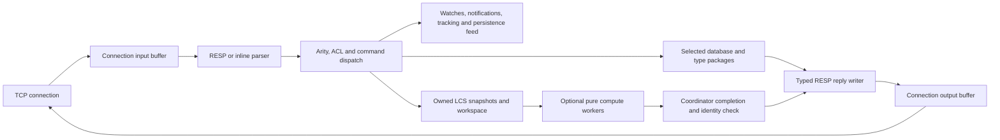
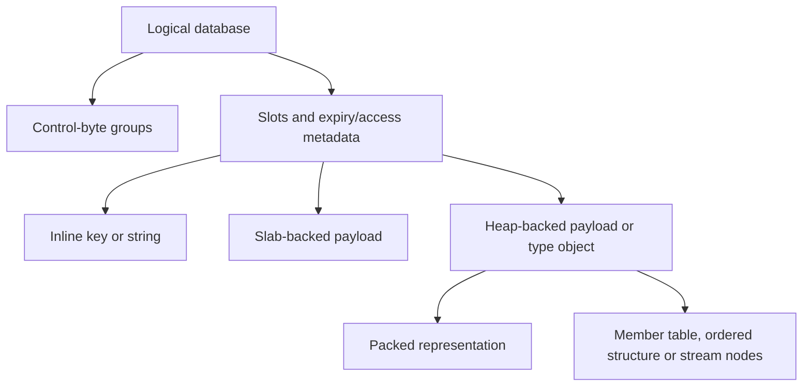

# Architecture

Eski has one foreground coordinator loop that owns live keyspace and connection state. Each connection owns its input/output buffers, authentication state, selected database, protocol mode and optional subscription, tracking, blocked-operation or transaction state. Linux epoll supplies readiness events; the loop accepts connections, reads available bytes, executes requests and flushes replies. Optional [LCS compute workers](threading.md) use immutable snapshots and private workspaces while the coordinator continues servicing other connections.

## Parsing and execution

The request parser distinguishes complete, incomplete and malformed input and applies array/bulk limits before dispatch. It preserves input ownership where inline parsing needs a stable buffer. A connection can pipeline multiple complete commands. Dispatch resolves a registered command and optional subcommand, checks arity, derives key arguments, enforces ACL and loading/transaction restrictions, and invokes the handler. RESP2 and RESP3 use the same command semantics with protocol-appropriate reply forms.

The default temporary allocator is reset at the event-loop iteration boundary. A command can use scratch storage for transient processing, but data retained by the database, a queued operation or a connection must own its allocation. Replies remain owned until written. See [connections and protocol](connections-and-protocol.md) and [transactions](transactions.md).

Eligible large LCS requests can leave one pending computation on a connection. Their arguments and values are copied before admission, and later commands on that connection wait for completion. Worker code accesses its private snapshots/workspace; the coordinator formats replies and updates hooks/statistics. Admission has fixed job and byte bounds and falls back to synchronous execution under pressure, inside transactions/loading, or for tracking-enabled sources. GET/SET and other keyspace handlers retain coordinator ownership. Compute workers stop and join before background persistence forks and shutdown; see [threading](threading.md) for lifecycle and observation details.

## Keyspace and values

The database table separates compact control bytes from a structure-of-arrays slot region. Lookup hashes a key, checks a group of control bytes and compares only candidate keys. Slots carry expiry/access metadata and compact key/value handles. Short strings fit in handles; larger payloads use slab or heap storage, and collection handles reference type-specific objects. The representations and accounting are in `src/table.odin`, `src/value.odin` and `src/memory_storage.odin`.

Storage packages manage lists, hashes, sets, sorted sets, packed values, bitmaps, HLL and stream records. Representation changes depend on size/configuration rather than changing the logical type. Ownership and usable-memory accounting flow back to the database. An allocation limit or representation threshold should not be interpreted as an exact process-RSS guarantee.

## Maintenance

Keyspace resizing and member-table migration use bounded work steps. The event loop also advances maintenance while traffic is quiet. Slab reclamation and lazy freeing have separate work queues. The periodic cron path performs expiry work, persistence scheduling, subscription maintenance, idle-client checks and statistics updates.

Expiry is lazy on access and active through a budgeted sweep over database metadata. Hash field deadlines use a registry so active field expiry can find relevant hashes without sweeping every hash. A key mutation also participates in watched-key invalidation, pub/sub notifications, tracking invalidation and the persistence feed. These effects are coordinated with transaction and blocked-client execution.

## Persistence and blocking work

RDB snapshots and append-only files are independent local durability mechanisms. Background save/rewrite operations use process/fork plumbing and shared accounting rather than executing a second foreground command stream. Lazy-free work can run outside the command loop. Some commands, large replies, synchronous persistence and maintenance still consume foreground time; bounded migration alone does not make every request bounded.

Blocking list, sorted-set and stream commands register waiting connections and wake them after relevant changes or timeouts. Transactions queue requests and execute them without interleaving another foreground client's commands, but do not roll back successful commands after a runtime error.

This repository does not implement network replication or a distributed cluster. Node placement, routing and coordination can be supplied by a separate system; no Rust control plane is included here. The [roadmap](../ROADMAP.md) and [conformance results](conformance.md) identify the current boundaries.
